# Short Background 

Cardiovascular diseases are the leading cause of death worldwide. Atherosclerosis, the predominantly underlying disease, is a chronic inflammatory disease to which various immune cells contribute. The "dont eat me" signal CD47 is overexpressed in the atherosclerotic plaque and prevents efficient removal of apoptotic cells by macrophages. Blocking this axis with the Checkpoint inhibitor anti-CD47 was shown to reduce inflammation and plaque size. Previous results in our group showed that depletion of CD8+ T cells abolished this therapeutic effect. In my thesis project I want to investigate the role of CD8+ T cells in anti-CD47 treatment further. To assess the systemic effect of anti-CD47 on CD8+ T cells, I analyze data from ldl-receptor KO mice (model for atherosclerosis) treated with anti-CD47 or IgG-control antibody that have been fed a high-fat diet to induce atherosclerosis. The mouse experiments have been conduced prior to my start in the group. Spleens have been harvested from mice and CD8+ T cells were isolated using magnetic bead sorting. I was responsible for RNA isolation from isolated CD8+ Tcells that have been stored in RNAprotect, for the sample prep for sequencing, and the following Fastq processing and data analyis.

I have used the Galaxy platform for data processing, quality control and generation of count matrices using the following pipeline:
-> *FASTQC* to check quality of raw files
-> *Trimmomatic* for read timming 
-> *HISAT2* for read alignment
-> *FASTQC* to check aligmnet
-> *Feature Counts* to quantify gene expression
-> *FASTQC* to check assignment 

Count matrices were downloaded and further processed in R. Most of this code is based on the Deseq2 Vignette (https://bioconductor.org/packages/devel/bioc/vignettes/DESeq2/inst/doc/DESeq2.html) and workflow (https://master.bioconductor.org/packages/release/workflows/vignettes/rnaseqGene/inst/doc/rnaseqGene.html)

# load Packages 


``` r
library(DESeq2)
library(RColorBrewer)
library(pheatmap)
library(tidyverse)
library(purrr)
library(ggrepel)
library(readxl)
library(biomaRt)
library(ComplexHeatmap)
library(circlize)
library(AnnotationDbi)
library(org.Mm.eg.db)
library(msigdbr)
library(clusterProfiler)
```


# Load count matrix

Since we have 16 samples its easier to write a function that loops though the data folder instead of reading in each file individually.


``` r
counts_dir <- "data/counts"
test <- read.delim("data/counts/A286.fq.tabular") # check for one sample how the df looks -> weird sample_id, remove .fq in the loop 
head(test)
```

```
##               Geneid A286.fq
## 1 ENSMUSG00000104478       0
## 2 ENSMUSG00000104385       0
## 3 ENSMUSG00000101231       0
## 4 ENSMUSG00000101097       0
## 5 ENSMUSG00000100764       7
## 6 ENSMUSG00000100831       0
```

``` r
colnames(test) <- c("gene_id", "A286") #test renaming of columnname

# create a vector of all the files present in the folder "counts" 
count_files <- list.files(path = counts_dir, pattern = "\\.tabular$", full.names = T)

read_count_file <- function(file_path) {
  sample_id <- tools::file_path_sans_ext(basename(file_path)) #basename calls the file name from the path: "data/counts/A286.fq.tabular" -> "A286.fq.tabular", and file_path_sans_ext removes the tabular extension -> "A286.fq"
  sample_id <- gsub("\\.fq", "", sample_id) #remove .fq extension; now we only get e.g. A286
  
  df <- read.delim(file_path, header = T)
  
  df <- df[, 1:2] #safety step to only keep the first two colums (in case we have additional columns, count matrices form featurecount output of individual samples should only have geneID and count column)
  
  colnames(df) <- c("gene_id", sample_id)
  
  return(df)
}

# now we read the files with the function we just created and merge all dataframes to generate one big count matrix
count_list <- lapply(count_files, read_count_file) #for now we have created a list that contains the dfs read in by the function

# merge this list into one matrix
count_matrix <- purrr::reduce(count_list, full_join, by = "gene_id")

# set row names to gene IDs and delete gene_id column
rownames(count_matrix) <- count_matrix$gene_id
count_matrix <- count_matrix[, -1]

#View the final matrix
head(count_matrix)
```

```
##                    A286 A287 A288 A289 A297 A298 A299 A300 B282 B283 B290 B292
## ENSMUSG00000104478    0    0    0    0    0    0    0    0    0    0    0    0
## ENSMUSG00000104385    0    0    0    0    0    0    0    0    0    0    0    0
## ENSMUSG00000101231    0    0    0    0    0    0    0    0    0    0    0    0
## ENSMUSG00000101097    0    0    0    0    0    0    0    0    0    0    0    0
## ENSMUSG00000100764    7    7   11   14    4   10    8    5    3    0    6    3
## ENSMUSG00000100831    0    0    0    0    0    0    0    0    0    0    0    0
##                    B293 B294 B295 B296
## ENSMUSG00000104478    0    0    0    0
## ENSMUSG00000104385    0    0    0    0
## ENSMUSG00000101231    0    0    0    0
## ENSMUSG00000101097    0    0    0    0
## ENSMUSG00000100764    3    2    5    7
## ENSMUSG00000100831    0    0    0    0
```

``` r
#write.csv(count_matrix, file = "counts_matrix_raw.csv")
```

# Metadata table

In order to later compare the conditions CD47 treated and IgG isotope control, we have to add metadata that states, which samples are which. For this we create a df containing the condition info. In the metadata we can also add out info such as age, sex, strain etc, by we we can later compare.


``` r
metadata <- read_excel("Data/Metadata.xlsx", col_names = T) #we load metadatafile and have to create a df with rownames that are exactly the same and in the same order as the count matrix!
metadata <- as.data.frame(metadata)
rownames(metadata) <- metadata$sample
metadata <- metadata [, -1]

#check if all samples from the count matrix are in metadata and in the same order
all(rownames(metadata) == colnames(count_matrix))
```

```
## [1] TRUE
```

# DESeq2 object
We will now create the DESeq2 object that we will use for differential gene expression analysis


``` r
dds <- DESeqDataSetFromMatrix(countData = count_matrix,
                              colData = metadata,
                              design = ~gender + condition) #like this we include gender as a covariate in the general linear model
```

```
## Warning in DESeqDataSet(se, design = design, ignoreRank): some variables in
## design formula are characters, converting to factors
```

``` r
dds
```

```
## class: DESeqDataSet 
## dim: 78317 16 
## metadata(1): version
## assays(1): counts
## rownames(78317): ENSMUSG00000104478 ENSMUSG00000104385 ...
##   ENSMUSG00002074899 ENSMUSG00002076890
## rowData names(0):
## colnames(16): A286 A287 ... B295 B296
## colData names(3): condition gender batch
```

``` r
#condition is converted from a character to a factor. We can now set levels to these factors in the order we want

#set IgG as the reference level
dds$condition <- relevel(dds$condition, ref = "IgG")
```

The DESeq2 object is a list-like S4 object called DESeqDataSet (dds) and contains several slots.


# Prefilterring
We filter our data to remove genes with very low counts and also regard group size.

``` r
nrow(dds)
```

```
## [1] 78317
```

``` r
smallestGroupSize <- 8
keep <- rowSums(counts(dds) >= 10) >= smallestGroupSize
dds <- dds[keep,]
nrow(dds)
```

```
## [1] 17418
```
We reduced number of genes from 78 000 to 17 000 suggesting that a lot of genes had low expression


# Data exploration
For data exploration and visualization I will perform hierachical clustering and PCA. This can give us a first impression whether observed clusters represent our treatment and examine other factors that could have effected the expression. Since RNAseq data is not homoscedastic (variance increases with increasing mean) we need to transform our count matrix since methods such as PCA expect homoscedastic data.

## Hierachical clustering


``` r
vsd <- vst(dds, blind = T) #blind = T -> across all samples variability, blind = F -> within group variability (design-formula)

#extract matrix of transformed counts
vsd_mat <- assay(vsd)

distance <- dist(t(assay(vsd)), method = "euclidian") #dist functions calculates distance between rows: since we want distance btw samples we transpose
distance_mat <- as.matrix(distance)
rownames(distance_mat) <- vsd$condition
pheatmap(distance_mat,
         clustering_distance_rows = distance,
         clustering_distance_cols = distance
         )
```

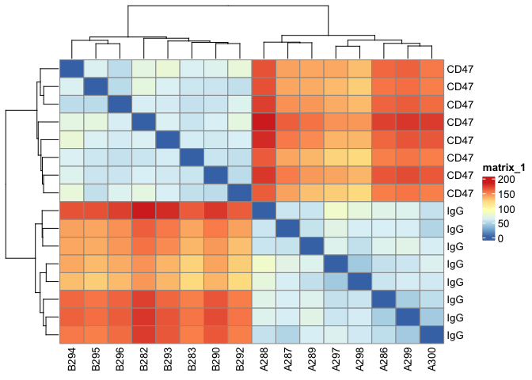<!-- -->

Treated and control groups are well separated. Distance seems to we very high between conditions


## PCA

To get a first idea of the data and investigate whether the samples cluster together based on the treatment we perform a principle component analysis. First we check in a Screeplot, which PCs explain how much variance.


``` r
ntop <- 500 #choose the top 500 variable expressed genes (including all genes could )
rv <- rowVars(assay(vsd))
select <- order(rv, decreasing = TRUE)[seq_len(min(ntop, 
            length(rv)))]
vsd_500 <- assay(vsd[select,])
        
pca_res <- prcomp(t(vsd_500), scale. = FALSE, retx=T) #PCA from stats package

pc_var <- pca_res$sdev^2 # sdev^2 captures eigenvalues from the PCA result
pc_per <- round(pc_var/sum(pc_var)*100, 1) # we can then use these eigenvalues to calculate the percentage variance explained by each PC

barplot(pc_per, names.arg = colnames(pca_res$x))
```

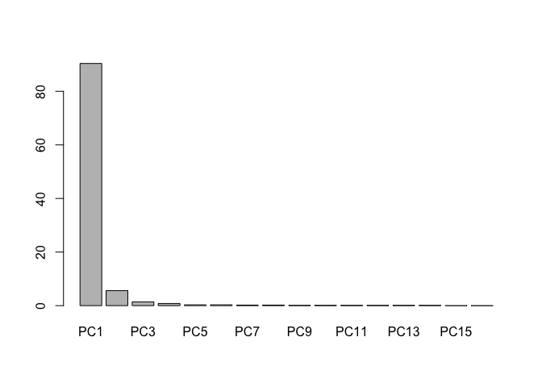<!-- -->

An unusually high percent of the variance is explained by PC1. Since we dont know yet how  CD47 inhibition effects  CD8+ Tcells this could be a treatment-induced effect. However, since it the same cell type isolated from the same tissue (not e.g. a different tissue where high variance would be expected). This could be a hint of a technical artifact...

To investigate where variance comes from we can plot the PCA results in combination with our metadata.


``` r
pca_res_df <- pca_res$x[,1:3] %>%
  as_tibble() %>%
  add_column(sample = rownames(metadata),
             treatment = metadata$condition,
             gender = metadata$gender,
             batch = metadata$batch
             )

pca_tidy <- pivot_longer(pca_res_df,
                         cols = PC1:PC3, 
                          names_to = "PC", 
                          values_to = "loadings")
```


``` r
ggplot(pca_tidy) +
  aes(x = sample, y = loadings, fill = treatment) + #exchange fill by other parameters (gender, batch)
  geom_bar(stat="identity") +
  facet_wrap(~PC) +
  labs(title="PCA 'small multiples' plot",
       caption=paste0("produced on ", Sys.time())) +
  theme_bw() +
  coord_flip()
```

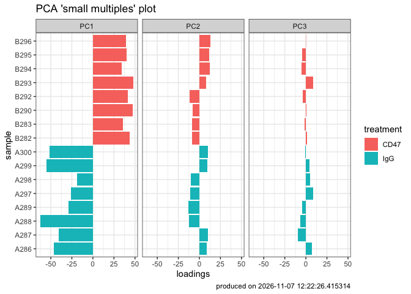<!-- -->

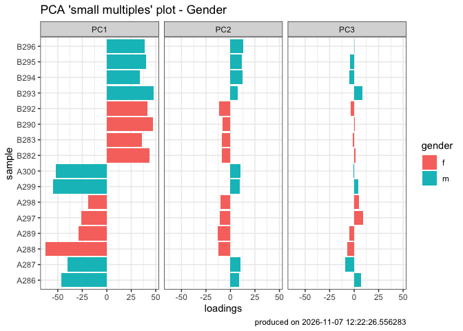<!-- -->

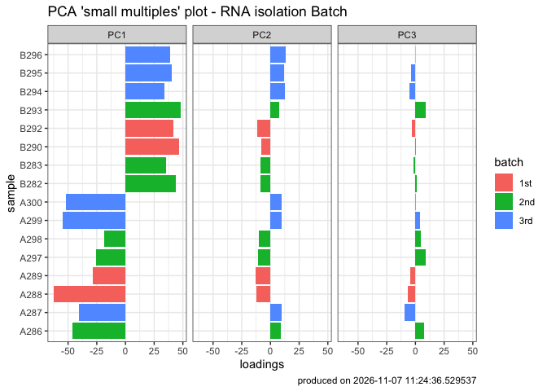<!-- -->

PC1 is explained by the treatment, while PC2 is explained by the gender. Batch (RNA isolation) might have had a very small effect. 

We can plot other PCs to check:

``` r
plotPCA(vsd, intgroup = "batch", pcsToUse = 2:3)
```

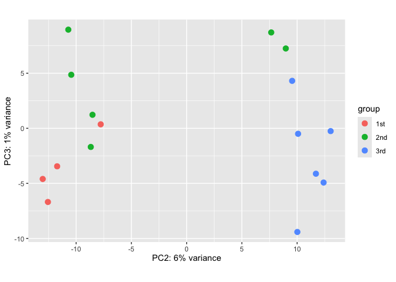<!-- -->

Similar visualization of PC1/PC2 wiht plotPCA from DESeq2 package:


``` r
pcaData <- plotPCA(vsd, intgroup = "condition", returnData = TRUE)
```

```
## using ntop=500 top features by variance
```

``` r
# Add sample names as labels
percentVar <- round(100 * attr(pcaData, "percentVar"))
PCAplot <- ggplot(pcaData, aes(PC1, PC2, color=condition, shape = metadata$gender, #label = name
                            )) +
  geom_point(size=3) +
 # geom_text_repel()+
  xlab(paste0("PC1: ", percentVar[1], "% variance")) +
  ylab(paste0("PC2: ", percentVar[2], "% variance")) +
  coord_fixed()
PCAplot
```

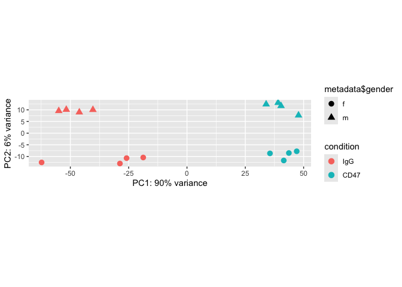<!-- -->

``` r
#ggsave("QC-PCA-gender.png", path = output, plot = PCAplot, height = 4)
```

Due to this quite extreme variance explained by PC1 -> inspect loadings (meaning genes that drive PC1)


### PCA Loadings
top loadings are the genes most responsible for variance in PCs


``` r
# Get top 20 genes contributing to PC1 using $rotation 
pc1_loadings <- pca_res$rotation[, 1]  # get first column (PC1) of genes contributing to PC1
pc1_loadings_sorted <- sort(abs(pc1_loadings), decreasing = TRUE)[1:20]  #sort to get genes that contibute most
pc1_top_genes <- names(pc1_loadings_sorted)

# View as a data frame
pc1_loadings_df <- tibble(
  gene = names(pc1_loadings_sorted),
  loading = pc1_loadings_sorted
)

#easy way to get gene Name and short description using Biomart
mart <- useEnsembl(biomart = "ENSEMBL_MART_ENSEMBL",
                   dataset = "mmusculus_gene_ensembl",
                   host = "https://e115.ensembl.org",
                   )
attributes <- listAttributes(mart)
mmus_anno <- getBM(attributes = c("ensembl_gene_id", "external_gene_name", "wikigene_description"), 
                   mart = mart) 

pc1_loadings_df_description <- pc1_loadings_df %>%
  left_join(mmus_anno, by = c("gene" = "ensembl_gene_id"))

print(pc1_loadings_df_description$gene)
```

```
##  [1] "ENSMUSG00000008843" "ENSMUSG00000091694" "ENSMUSG00000022099"
##  [4] "ENSMUSG00000121605" "ENSMUSG00000028825" "ENSMUSG00000056656"
##  [7] "ENSMUSG00000021118" "ENSMUSG00000042066" "ENSMUSG00000121431"
## [10] "ENSMUSG00000027562" "ENSMUSG00000028332" "ENSMUSG00000068417"
## [13] "ENSMUSG00000023926" "ENSMUSG00000051839" "ENSMUSG00000034127"
## [16] "ENSMUSG00000034059" "ENSMUSG00000037872" "ENSMUSG00000020490"
## [19] "ENSMUSG00000050157" "ENSMUSG00000073940"
```
#### Top Loadings: 

**Cldn13:** stress induced erythropoiesis https://journals.plos.org/plosone/article?id=10.1371/journal.pone.0012667  
**Apol11b:** lipid transport.  
**Dmtn** structural role in erythrocytes, by stabilizing and attaching the spectrin/actin cytoskeleton to the erythrocyte membrane in a phosphorylation-dependent manner. https://www.ncbi.nlm.nih.gov/gene/2039. 
**Ahsp** (alpha hemoglobin stabilizing protein) -> Acts as a chaperone to prevent the harmful aggregation of alpha-hemoglobin during normal *erythroid cell development* Specifically protects free alpha-hemoglobin from precipitation  
**Rhd:**  Rh blood group, D antigen  
**Apol8:** apolipoprotein8, lipid transport  
**Plek2:** important in *erythropoiesis* (cytoskeleton) https://doi.org/10.3324/haematol.2014.105809  
**Tmcc2**: expressed by *erythroid* cells (Human protein atlas)  
**Gm62754**: NA  
**Car2:** Carbonic anhydrase2 (converts CO2 in bicarbonate), early  marker of the erythroid differentiation (https://www.sciencedirect.com/science/article/abs/pii/S187493991200106X)  
**Hemgn:** expressed in active hematopoietic sites and downregulated during erythrocyte differentiation  
**Pnp2:** highly expressed in erythrocytes (PMID: 33641045). 
**Rhag:** Rh-associated glycoprotein, erythrocyte specific (exchange of ammonium and CO2) https://www.ncbi.nlm.nih.gov/gene/6005  
**Gypa:** Glycophorin A, expressed on erythrocyte membrane, regulation of osmotic stress response (https://www.ncbi.nlm.nih.gov/gene/14934)  
**Tspan8:** not erythrocyte related; restricted to defined cell lineages -> marker for progenitor cells in mammary stem cells, germ cells, cancer stem cells... (PMC10814125)  
**Ypel4:** essential for erythrocyte membrane integrity, expressed in late terminal erythroid differentiation https://www.nature.com/articles/s41598-021-95291-1   
**Ackr1:** Atypical Chemokine Receptor 1, expressed by *nucleated erythroid cells* (PMC5480598)  
**Btnl10:** Butyrophilin Like 10, T cell receptor signalling pathway, regulation of cytokine production (https://www.genecards.org/cgi-bin/carddisp.pl?gene=BTNL10P)  
**Gm867:** predicted gene 867  
**Hbb-bt:** hemoglobin beta adult t chain; forms adult hemoglobin together with hemoglobin alpha  

**most of the top20 loading of PC1 are related to erythropoieisis. This is a strong hint that our RNAseq data of is contaminated by erythroid RNA. This propbaly overshadows systemic effects of anti-CD47 treatment on CD8+ T cells...**

# Heat map of possible contaminations

To investigate this further I check marker genes in relation to erythropoiesis 


``` r
marker_heatmap <- Heatmap(mat_markergenes,
        name = "Z score",
        cluster_columns = FALSE,
        cluster_rows = FALSE,
        row_split = row_groups,
        row_title_gp = gpar(fontsize = 10, fontface = "bold"),
        row_title_rot = 0,
        row_names_gp = gpar(fontsize = 8),
        column_split = sample_condition,
        column_names_rot = 45,
        column_names_gp = gpar(fontsize = 8),
        show_row_names = TRUE,
        show_column_names = TRUE)

print(marker_heatmap)
```

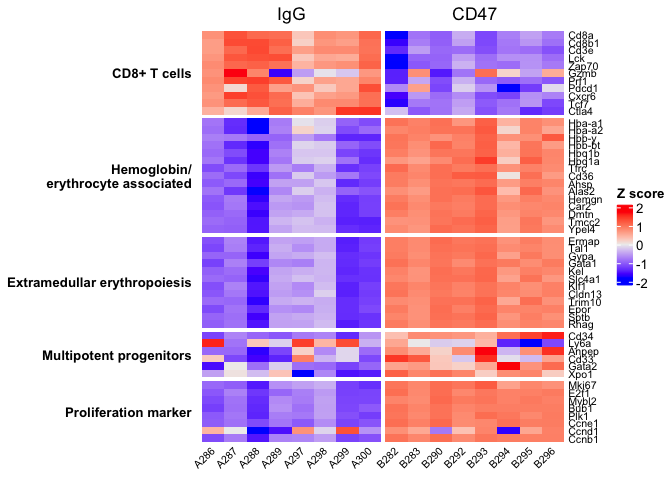<!-- -->
Plotting defined erythropoeisis-associated markers clearly shows that the CD47-treated samples are biased towards erythropoisis. This skews the expression of Cd8+ T cell associated genes that should not be different between the conditions. This suggests a contamination of erythroid genes that dominate detecable changes in CD8+ Tcells making it hard/impossible to determine expression coming from CD8+ T cells. Nevertheless, I will continue with the standard differential expression workflow and perform downstream pathway analysis.


# Differential gene expression analysis


``` r
dds <- DESeq(dds)
res <- results(dds)
```


# Extract Results

The results function performs independent filtering."The goal of independent filtering is to filter out those tests from the procedure that have no, or little chance of showing significant evidence, without even looking at their test statistic. Typically, this results in increased detection power at the same experiment-wide type I error. Here, we measure experiment-wide type I error in terms of the false discovery rate." (https://bioconductor.org/packages/devel/bioc/vignettes/DESeq2/inst/doc/DESeq2.html#indfilttheory)
The alpha value should be set to the FDR value you want to choose. 


``` r
res <- results(dds,
               alpha = 0.05)
summary(res)
```

```
## 
## out of 17418 with nonzero total read count
## adjusted p-value < 0.05
## LFC > 0 (up)       : 6694, 38%
## LFC < 0 (down)     : 6765, 39%
## outliers [1]       : 10, 0.057%
## low counts [2]     : 0, 0%
## (mean count < 7)
## [1] see 'cooksCutoff' argument of ?results
## [2] see 'independentFiltering' argument of ?results
```
We have a large amount of DEGs (~13 000) (probably due to erythrocyte contamination )

## MA plot


``` r
plotMA(res, ylim = c(-6, 6), alpha = 0.05)
```

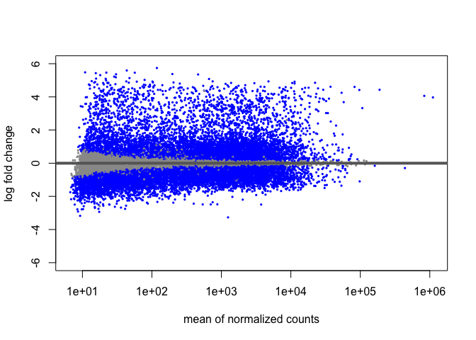<!-- -->
Blue dots indicate genes below the p-adj value of 0.05. We see many signigicant genes that are skewed to a positive logFC.

## Histogram 


``` r
hist(res$pvalue[res$baseMean > 1], breaks = 0:20/20,
     col = "grey50", border = "white")
```

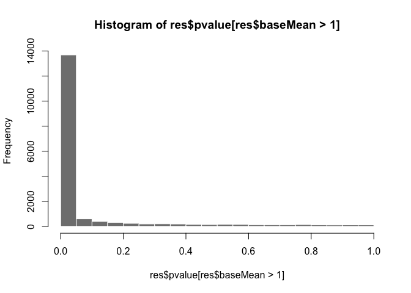<!-- -->
This again shows the untypically high amount of DEGs


# Visualization
## Add geneID for readability

First we convert the DESeqResults object to a dataframe


``` r
columns(org.Mm.eg.db)
```

```
##  [1] "ACCNUM"       "ALIAS"        "ENSEMBL"      "ENSEMBLPROT"  "ENSEMBLTRANS"
##  [6] "ENTREZID"     "ENZYME"       "EVIDENCE"     "EVIDENCEALL"  "GENENAME"    
## [11] "GENETYPE"     "GO"           "GOALL"        "IPI"          "MGI"         
## [16] "ONTOLOGY"     "ONTOLOGYALL"  "PATH"         "PFAM"         "PMID"        
## [21] "PROSITE"      "REFSEQ"       "SYMBOL"       "UNIPROT"
```


``` r
res$symbol <- mapIds(org.Mm.eg.db,
                     keys=rownames(res),
                     column="SYMBOL",
                     keytype="ENSEMBL",
                     multiVals="first")
```

```
## 'select()' returned 1:many mapping between keys and columns
```

``` r
res$entrez <- mapIds(org.Mm.eg.db,
                     keys=rownames(res),
                     column="ENTREZID",
                     keytype="ENSEMBL",
                     multiVals="first")
```

```
## 'select()' returned 1:many mapping between keys and columns
```

``` r
head(res)
```

```
## log2 fold change (MLE): condition CD47 vs IgG 
## Wald test p-value: condition CD47 vs IgG 
## DataFrame with 6 rows and 8 columns
##                     baseMean log2FoldChange     lfcSE      stat      pvalue
##                    <numeric>      <numeric> <numeric> <numeric>   <numeric>
## ENSMUSG00000039748  663.4909      2.8653282 0.1446183  19.81304 2.29781e-87
## ENSMUSG00000057363  452.3162      0.6293704 0.0768852   8.18585 2.70398e-16
## ENSMUSG00000038702   82.4664     -0.7280196 0.1505965  -4.83424 1.33656e-06
## ENSMUSG00000061024 1031.9944      0.5934430 0.1186065   5.00346 5.63095e-07
## ENSMUSG00000025911   38.5102      1.3203910 0.2295817   5.75129 8.85644e-09
## ENSMUSG00000057335 1174.6344     -0.0898068 0.0758640  -1.18379 2.36498e-01
##                           padj      symbol      entrez
##                      <numeric> <character> <character>
## ENSMUSG00000039748 1.72415e-85        Exo1       26909
## ENSMUSG00000057363 9.64961e-16        Uxs1       67883
## ENSMUSG00000038702 2.67406e-06        Dsel      319901
## ENSMUSG00000061024 1.15977e-06        Rrs1       59014
## ENSMUSG00000025911 2.06638e-08      Adhfe1       76187
## ENSMUSG00000057335 2.71370e-01      Cep170      545389
```

``` r
res_df <- as_tibble(res, rownames = "ensemblID") 
```
## Vulcano Plot


``` r
myvolcanoplot
```

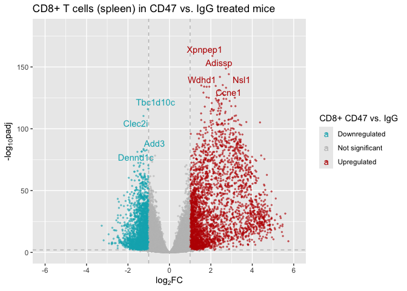<!-- -->

The Vulcanoplot shows again that we have many DEGs and more intense upregulation

## investigate most significant genes


``` r
top_down_genes <- res_df %>%
  filter(log2FoldChange < -1) %>%
  arrange(desc(neg_log10padj)) %>%
  slice_head(n = 40)

top_up_genes <- res_df %>%
  filter(log2FoldChange > 1) %>%
  arrange(desc(neg_log10padj)) %>%
  slice_head(n = 40)
```


``` r
print(top_up_genes$symbol)
```

```
##  [1] "Xpnpep1"  "Adissp"   "Nsl1"     "Wdhd1"    "Ccne1"    "Net1"    
##  [7] "Apip"     "Rfwd3"    "Ptpa"     "Glo1"     "Foxm1"    "Pabpc4"  
## [13] "Vkorc1l1" "Ncapd2"   "Tcf19"    "Comt"     "Cbx5"     "Shcbp1"  
## [19] "Prdx3"    "Lmnb1"    "Acp1"     "Polq"     "Mcm7"     "Mcm2"    
## [25] "Ccp110"   "Lig1"     "Klhl12"   "Prim1"    "Dclre1a"  "Atad5"   
## [31] "Incenp"   "Plk4"     "Scrn3"    "Spc24"    "Aplp2"    "Lancl2"  
## [37] "Mtfr1"    "Dek"      "Nsd2"     "Pacsin2"
```

**Upregulated in CD47 treated samples**:  

**Xpnpep1**:
**CCNE1**: CCNE1’s immunomodulatory properties, demonstrating that silencing impeded macrophage movement and decreased PD-L1 expression (https://molecular-cancer.biomedcentral.com/articles/10.1186/s12943-024-02169-7)  
results showed that CCNE1 expression level was negatively correlated with the infiltration of CD8 + T cell, macrophage and DC cell, and positively correlated with the infiltration of neutrophil in UCEC https://pmc.ncbi.nlm.nih.gov/articles/PMC10037856/  
**Wdhd1**: negative correlation between WDHD1 and the infiltration of several immune cells, including CD8+ T cells, cytotoxic cells, dendritic cells (DCs), and plasmacytoid DCs (pDCs), all of which play crucial roles in the body’s anti-tumor (immunityhttps://pmc.ncbi.nlm.nih.gov/articles/PMC10523704/)  
**Shcbp1**: Smyd3-Shcbp1 oncogenic signaling could reduce the function of effector cells (https://www.nature.com/articles/s41419-025-07570-8#Sec2)  


**Downregulated in CD47 treated samples**:  

**TLR1** - toll like receptor 1, TLR signaling pathways in T cells are required for the effective clonal expansion of antigen-specific T cells during infection in vivo . TLR expression regulated by TCR-dependent activation -> upregulated when T cell is activated via TCR. TLR ligands can promote more effective T cell-mediated immunity by acting directly on CD4+ and CD8+ T cells to enhance their respective effector functions. (https://pmc.ncbi.nlm.nih.gov/articles/PMC4486050/). effect on PD-1 expression: decrease after stimulation with TLR agonists (https://link.springer.com/article/10.1007/s12026-009-8113-x)   
**Prdm9** - plays role in CD8+ T cell differention in effector cell fate https://pmc.ncbi.nlm.nih.gov/articles/PMC11924876/  
**Trbj1-3**: Predicted to be involved in adaptive immune response. Predicted to be located in plasma membrane. Predicted to be part of T cell receptor complex (https://www.ncbi.nlm.nih.gov/gene/28633)  


**We do see interesting genes in our DEG analysis. However since our anti-CD47 treated group is greatly contaminated by Nucleated Red Blood Cells **

# Pathway analysis

We will start with the curated Hallmark geneset from msigDb

``` r
#Prepare Hallmark Gene set
H_mmus <- msigdbr(species = "Mus musculus", 
              collection = "H") %>%
  dplyr::select(gs_name, ensembl_gene)

H_mmus$gs_name <- gsub("HALLMARK", "", H_mmus$gs_name)
H_mmus$gs_name <- gsub("_", " ", H_mmus$gs_name)
```

Prepare background and data for over representation analysis (ORA)

``` r
background <- res_df$ensemblID

deg_sig <- res_df %>%
  filter(padj <= 0.05,
         abs(log2FoldChange) >= 1) %>%
  pull(ensemblID)
```

Perform ORA using Clusterprofiler

``` r
H_all <- enricher(gene = deg_sig,
                      universe = background,
                      TERM2GENE = H_mmus)
dotplot(H_all)
```

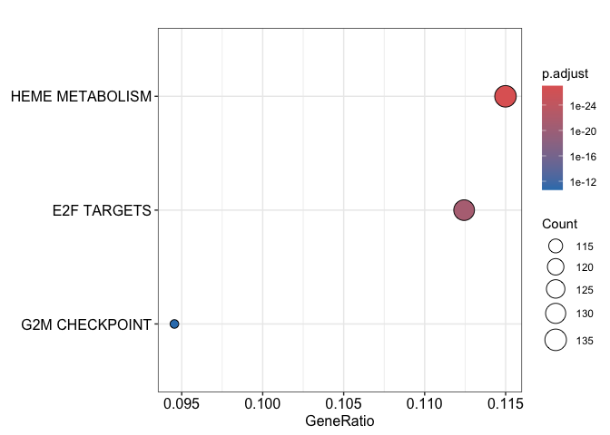<!-- -->

This shows us that erythropoiesis related pathways (heme metabolism) are upregulated, which we would not expect from clean CD8+ Tcell data. 

# Summary
CD47 is a ubiquitously expressed "dont-eat me" signal. Studies showed that it is upregulated in atherosclerotic lesions, which impairs efficient removal of apoptotic cells by macrophages and contributes to lesion growth (PMC4980260.) However, erythrocytes express CD47 to prevent phagocytosis by macrophages in the spleen. As they age, erythrocytes lose this signal and are removed. When treating mice systemically with anti-CD47 antibody, erythrocytes are increasingly degrade which causes splengomegalie. During the isolation of CD8+ T cells several steps of blood lysis are performed to get rid of erythrocytes followed by magnetic isolation of CD8+ T cells (negative selection). However, this data suggests that a lot of erythrocytes, specifically erythroid precursor cells, are still present. In adult mice, erythrocytes are mainly produced in the bone marrow, but under pathological conditions extramedullary hematopoiesis can compensate for increased erythrocyte loss. Immature erythrocytes are in that case commonly found (https://doi.org/10.7554/eLife.92679). Red blood cell lysis is usually based on osmotic pressure through an abundant membrane Cl—/HCO3— anion exchange present on mature erythrocytes. This could explain why progenitors are still highly present and contaminate the RNA sample.

Since the erythropoietic genes contaminate exclusivly the CD47 treated samples, I currently dont see a possibility to bioinformatically remove this effect. Although  T cell related genes are significantly differentially expressed, Im not sure whether this stems from true biological signal or overshadowing by erythrocyte genes that "occupy" so many reads that skew the aparent differences in expression.

Nevertheless, this project showed that rigorous inspection of the data can identify contaminated samples. With this lesson learned, another round of CD8+ T cell sequencing should be performed on FACS sorted cells to prevent such contamination.


